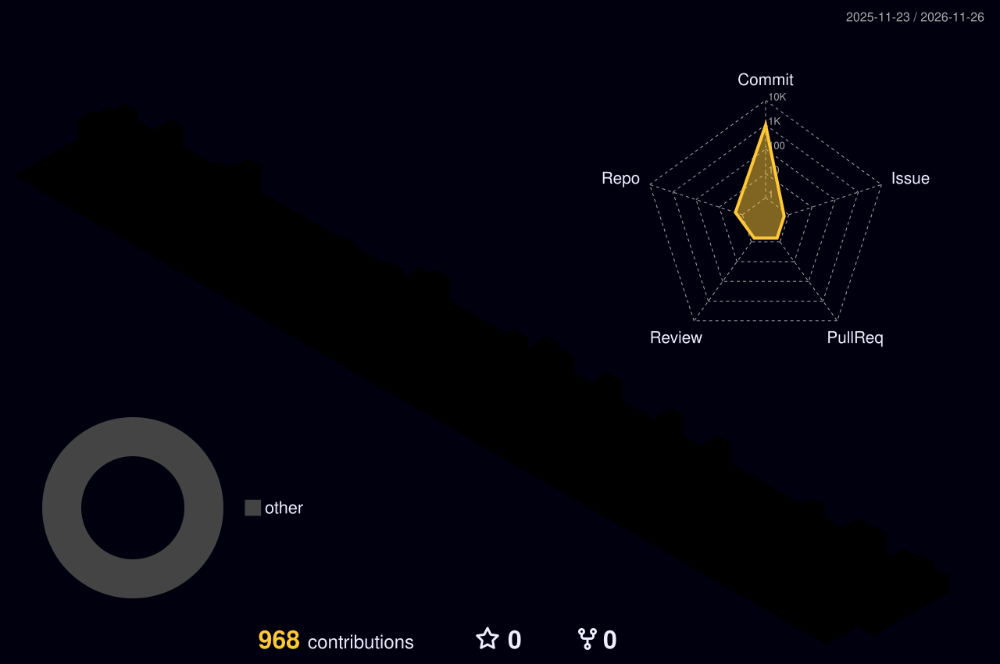

<div align="center">

<!-- Animated 3D-Style Waving Header Banner -->


<!-- Dynamic Typing Subtitle -->
<a href="https://github.com/Mandipdevrai">
  
</a>

<br/>

<!-- 3D Elevated Social & Portfolio Badges -->
<p align="center">
  <a href="https://github.com/Mandipdevrai/portfolio">
    
  </a>
  <a href="https://github.com/Mandipdevrai?tab=repositories">
    
  </a>
  <a href="https://www.linkedin.com/">
    
  </a>
</p>

</div>

---

### 🧊 3D Isometric Contribution Skyline

<div align="center">
  <picture>
    <source media="(prefers-color-scheme: dark)" srcset="https://raw.githubusercontent.com/Mandipdevrai/Mandipdevrai/main/profile-3d-contrib/profile-night-rainbow.svg" />
    <source media="(prefers-color-scheme: light)" srcset="https://raw.githubusercontent.com/Mandipdevrai/Mandipdevrai/main/profile-3d-contrib/profile-green-animate.svg" />
    
  </picture>
</div>

---

### ⚡ Engineering Profile (`Mandipdevrai.cs`)

```csharp
public sealed class MandipRai : ISoftwareArchitect
{
    public string Role => ".NET & Python Expert";
    public string[] CoreStacks => new[] { "C# / .NET 8+", "Python 3.12+", "ASP.NET Core", "FastAPI / Django" };
    public string[] Architecture => new[] { "Microservices", "REST & gRPC APIs", "Event-Driven Systems", "Cloud-Native" };
    public string FlagshipRepo => "[https://github.com/Mandipdevrai/portfolio](https://github.com/Mandipdevrai/portfolio)";

    public Solution Build(Problem problem) =>
        problem.Analyze()
               .ArchitectWithCleanPatterns()
               .ShipWithZeroDowntime();
}
